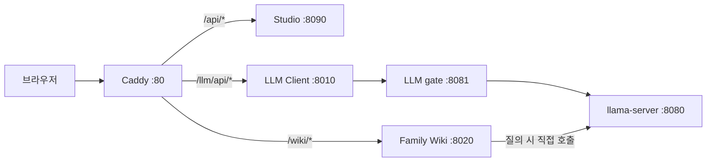

# BC-250 서비스 구성과 모델 관리 API 추가 계획

기준: 2026-11-03까지 운영자가 제공한 서비스 상태·Caddy 설정·Wiki 소스와 이 저장소의 배포 후보. 이 문서는 확인 당시의 구성 기록이며 실시간 상태나 전체 호스트 서비스 목록이 아니다. 새 모델 관리 구성은 아직 운영 서버에 설치되지 않았다. 비밀값은 기록하지 않는다.

## 현재 운영 중인 구성

| 서비스 또는 구성 | systemd unit | 확인된 주소 | 역할과 근거 |
| --- | --- | --- | --- |
| Caddy | `caddy.service` 후보 이름; 실제 unit 메타데이터 확인 필요 | 포트 80 | 브라우저 요청을 Studio·LLM Client·Wiki로 나눈다. 운영 Caddyfile 제공 내용 기준. 수신 인터페이스와 외부 공개 범위는 별도 확인 필요. |
| AI Studio | `bc250-ai-studio.service` | `127.0.0.1:8090` | 이미지 생성 API와 직렬 작업자. `ai-studio` 계정으로 실행되는 것이 확인됐다. Caddy가 Studio 프런트엔드도 제공한다. |
| LLM Client | `bc250-llm-client.service` | `127.0.0.1:8010` | LLM Client API. Caddy가 Client 프런트엔드도 제공한다. |
| LLM gate | `bc250-llm-gate.service` | `127.0.0.1:8081` | LLM 요청 수용 및 pause·drain 조율. 기존 환경 파일의 키로 인증 성공을 한 차례 확인했다. |
| llama-server | `llama-server.service` | `127.0.0.1:8080` | GGUF 모델을 로드해 LLM 추론 API를 제공한다. 운영 프로세스와 포트는 사용자가 제공한 상태 기준. |
| Family Wiki | `bc250-family-wiki.service` | `127.0.0.1:8020` | Wiki 문서·검색·질의 API. 제공된 코드의 질의는 gate를 거치지 않고 llama-server에 직접 요청한다. |
| TTM 설정 | `bc250-ttm.service` | 없음 | 부팅 시 TTM 메모리 설정을 적용하는 oneshot unit. `active (exited)`로 확인됐으며 HTTP 서비스가 아니다. |

서비스 상태 출력은 확인 시점의 증거다. 특히 Studio 모델 설정, gate 기존 pause·진행 및 대기 요청, llama health와 로컬 GPU 작업은 운영 적용 직전에 다시 확인해야 한다.

## 현재 브라우저 요청 경로

| Caddy 경로 | 전달 또는 처리 | 확인된 목적지 |
| --- | --- | --- |
| `/api/*` | 경로를 유지해 프록시 | Studio `127.0.0.1:8090` |
| `/llm/api/*` | `/llm`을 제거해 프록시 | Client `127.0.0.1:8010` |
| `/llm` | `/llm/`로 308 리다이렉트 | Client SPA |
| `/llm/*` | 접두사를 제거해 정적 파일 제공 | `/opt/bc250-llm-client/frontend/dist` |
| `/wiki` | `/wiki/`로 리다이렉트 | Wiki |
| `/wiki/*` | `/wiki`를 제거해 프록시 | Wiki `127.0.0.1:8020` |
| 그 밖의 경로 | 정적 파일과 SPA fallback | `/opt/bc250-ai-studio/frontend/dist` |

예를 들어 브라우저의 `/wiki/api/health`는 Wiki의 `/api/health`로 전달된다. 위 표는 운영자가 보여 준 Caddyfile을 기준으로 하며, 이 문서 작성 과정에서 설정을 변경하거나 실제 라우팅을 재검증하지 않았다.

그림의 Client→gate는 기존 Client의 gate 설정과 키 이전 계획을 나타낸다. Studio와 gate 사이의 GPU·요청 조율도 존재하지만 위 그림은 브라우저 및 LLM 요청의 주요 경로만 보여 준다. Wiki가 llama에 직접 접근하므로 gate pause만으로 모든 직접 요청이 차단되지는 않는다.

## 이번 배포에서 추가할 구성

| 구성 | 후보 unit 또는 경로 | 예정 주소·계정 | 역할 및 현재 상태 |
| --- | --- | --- | --- |
| 모델 관리 API | `bc250-model-api.service` | `127.0.0.1:8091`, `ai-studio` | 관리자 인증 후 모델 목록·전환 상태를 제공하는 후보. 최초 배포에서 모델 전환은 비활성으로 유지한다. 운영에 아직 설치되지 않았다. |
| 모델 관리 작업자 | `bc250-model-worker.service` | root, 단일 작업자 | 관리 API의 작업 처리 및 모델 전환·복구 조율 후보. 실제 전환은 사용자가 별도로 실행하기 전까지 수행하지 않는다. |
| 작업자 소켓 | `bc250-model-worker.socket` | `/run/bc250-model-control/control.sock` | 관리 API와 작업자의 로컬 Unix 소켓. HTTP 포트가 아니다. |
| Studio·gate·Client 추가 설정 | 각 서비스의 `50-model-control.conf` drop-in | 기존 서비스에 적용 예정 | 새 키·조율 설정을 연결하는 후보. Client는 설정 적용 뒤 운영자가 직접 재시작한다. |
| GPU 잠금 설정 | `bc250-gpu-lock.conf` tmpfiles 후보 | `/run/bc250-gpu/` | 새 Studio·작업자의 공용 잠금 경로와 작업자 전용 잠금을 준비하는 후보. 잠금만으로 모든 로컬 직접 호출이나 GPU 사용을 차단한다고 볼 수 없다. |
| 권한 및 상태 | polkit 규칙, `/etc/bc250-model-control/`, `/var/lib/bc250-model-control/` | root 관리, 접근 권한 분리 예정 | 키·설정, 전환 journal·작업 상태 및 서비스 제어 권한 후보. 비밀값을 출력하지 않는다. |

관리 API는 loopback 전용으로 계획돼 있으며, 제공된 현재 Caddyfile에는 `8091`로 가는 경로가 없다. 따라서 Caddy를 통한 외부 관리 API 노출은 현재 계획으로 확정된 것이 아니다. LLM Client 화면에서 모델을 선택하는 기능은 이번 범위가 아니다.

저장소에 있는 `bc250-model-control.socket`과 `bc250-model-control@.service`는 별도의 이전 읽기 전용 후보이며, 현재 최초 설치 파일 목록의 `bc250-model-worker.socket`·`bc250-model-worker.service`와 혼동해 동시에 설치하지 않는다.

## 배포와 확인 경계

- 운영 `/opt/bc250-ai-studio`는 Git 저장소가 아니다. 기존 GitHub Actions는 SSH로 배포해 왔고, 새 통합 배포 Actions는 아직 완성되지 않았다. 기존 Studio 전용 배포 차단은 로컬 워크플로에서 확인했으며 원격 반영 여부는 별도 확인해야 한다.
- 배포 시 Caddy 유지보수, Wiki 직접 호출 차단, gate pause 기록·drain, 서비스 정지, 백업, 설치와 확인, Client 수동 재시작, 유지보수 해제를 연결해야 한다. 다른 로컬 직접 호출과 GPU 유휴 상태를 지속적으로 보장하는 절차는 미완성이다.
- 실패 시 새 journal·gate hold와 데이터를 보존하고 기존 코드·데이터·설정·서비스를 호환되는 단위로 복원해야 한다. 현재 활성 모델 설정 `/opt/ai/config/active-model.conf`는 임의로 변경하지 않는다.
- 시험 결과와 남은 항목의 현재 상태는 [모델 관리 API 배포 작업 목록](./LLM_MODEL_SWITCH_DEPLOYMENT_TASKS.md)을 따른다. 운영 서비스 경로와 상태는 배포 직전에 재확인한다.
- SSH는 집 내부 `ssh -p 22 yeppyshiba@192.168.0.57`, 외부 `ssh -p 2222 yeppyshiba@yeppyshiba.iptime.org`를 사용한다.
